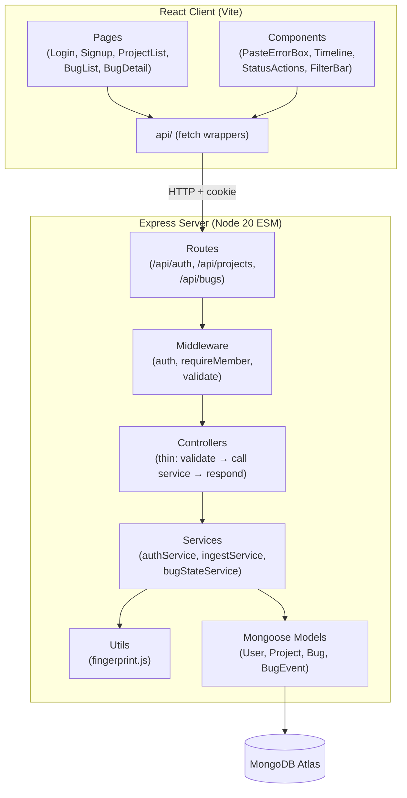

# Design Document

## DevLoop Mini

---

## Overview

DevLoop Mini is an error-tracking and bug-collaboration tool for developers working with AI coding assistants. The central design problem is **bug identity loss**: the same failure recurs across files and sessions, but flat ticket lists treat each recurrence as a new bug. DevLoop Mini solves this by modeling a bug as a persistent identity defined by a deterministic fingerprint, with an append-only event timeline that accumulates every occurrence, status change, and comment.

The system is a MERN application:

- **Server**: Node 20 (ESM modules), Express, MongoDB Atlas via Mongoose
- **Client**: React + Vite (SPA)
- **Auth**: bcrypt password hashing + JWT in HttpOnly cookies
- **Validation**: Zod schemas on all inbound request bodies and query params
- **Testing**: Jest + Supertest against a dedicated test MongoDB instance

The ingest path is a browser UI paste box (session-authenticated) that calls a single `Ingest_Service` function, ensuring consistent deduplication, regression detection, and event recording.

---

## Architecture

### High-Level Component Diagram



### Request Flow

1. React `api/` layer sends `fetch` with `credentials: 'include'`
2. Express `auth` middleware verifies the JWT HttpOnly cookie
3. `requireMember` middleware resolves project membership from the URL param or bug's project reference
4. Controller delegates entirely to the relevant service function
5. Service applies business logic, writes to MongoDB, returns a plain result object
6. Controller serialises the result to JSON with the correct HTTP status code

Business logic lives exclusively in `services/`. Route handlers contain no business logic — only request/response shaping.

### Directory Structure

```
server/
  src/
    config/         # db.js (Mongoose connect), env.js (validated env vars)
    models/         # User.js, Project.js, Bug.js, BugEvent.js
    routes/         # auth.js, projects.js, bugs.js, ingest.js
    controllers/    # authController.js, projectController.js,
                    # bugController.js, ingestController.js
    services/       # authService.js, ingestService.js,
                    # bugStateService.js
    middleware/     # authenticate.js, requireMember.js, validate.js
    utils/          # fingerprint.js
  index.js          # app bootstrap

client/
  src/
    pages/          # LoginPage, SignupPage, ProjectListPage,
                    # BugListPage, BugDetailPage
    components/     # PasteErrorBox, BugTimeline, StatusActions,
                    # BugFilters, ProjectForm, NavBar
    api/            # auth.js, projects.js, bugs.js, ingest.js
  main.jsx
  App.jsx           # React Router routes
```

---

## Components and Interfaces

### Middleware Chain

#### `authenticate` middleware (`middleware/authenticate.js`)

Reads the `token` HttpOnly cookie, verifies with `jsonwebtoken`, attaches `req.user = { id, email }`. Returns 401 if missing/invalid/expired.

#### `requireMember` middleware (`middleware/requireMember.js`)

Single reusable function. Two resolution modes, selected by which param is present:

- **Project-scoped routes** (`:projectId` in path): loads `Project.findById(req.params.id)`, checks `project.owner.equals(req.user.id) || project.members.includes(req.user.id)`. Returns 404 on failure (indistinguishable from non-existent).
- **Bug-scoped routes** (`:bugId` in path): loads `Bug.findById(req.params.bugId).populate('project')`, then applies the same owner/member check. Returns 404 on failure.

Attaches `req.project` (and optionally `req.bug`) for downstream use. Never trusts a `projectId` from the request body or query string.

#### `validate(schema)` middleware (`middleware/validate.js`)

Accepts a Zod schema. Parses `req.body` (or `req.query` for GET routes). On `ZodError`, returns 400 with the first failing field message.

### Service Interfaces

```
authService.signup(email, password)         → { id, email }
authService.login(email, password)          → { id, email, token }
authService.me(userId)                      → { id, email }

ingestService.ingest(projectId, message, stack)  → BugDocument
// Used by the member ingest route

bugStateService.transition(bugId, toStatus, memberId, version, currentStatus)
                                            → BugDocument
```

All service functions throw typed errors (`AppError` with `statusCode` and `code`) that controllers catch and map to HTTP responses.

---

## Data Models

### User

```js
// models/User.js
{
  email:        { type: String, required: true, unique: true, lowercase: true, trim: true },
  passwordHash: { type: String, required: true },
  createdAt:    { type: Date, default: Date.now }
}
```

Passwords are hashed with `bcrypt` (cost factor 12) before storage. The plaintext password is never stored or logged.

---

### Project

```js
// models/Project.js
{
  name:         { type: String, required: true, minlength: 1, maxlength: 100, trim: true },
  owner:        { type: ObjectId, ref: 'User', required: true },
  members:      [{ type: ObjectId, ref: 'User' }],
  createdAt:    { type: Date, default: Date.now }
}
```

`members` does not include the owner. Membership checks test `owner` and `members` separately.

---

### Bug

```js
// models/Bug.js
{
  project:        { type: ObjectId, ref: 'Project', required: true },
  fingerprint:    { type: String, required: true, length: 16 },
  title:          { type: String, required: true },        // first 120 chars of normalized message
  status:         { type: String, enum: ['open','in_progress','fixed','wontfix'], default: 'open' },
  severity:       { type: String, enum: ['low','medium','high','critical'], default: 'medium' },
  assignee:       { type: ObjectId, ref: 'User', default: null },
  occurrenceCount: { type: Number, default: 0 },
  regressions:    { type: Number, default: 0 },
  lastSeen:       { type: Date, default: Date.now },
  errorType:      { type: String, default: 'UnknownError' },
  createdAt:      { type: Date, default: Date.now }
}
```

**Indexes:**
- `UNIQUE { project: 1, fingerprint: 1 }` — enforces one Bug per distinct failure per project
- `{ project: 1, lastSeen: -1 }` — supports the default sort for the bug list
- `{ project: 1, status: 1 }`, `{ project: 1, severity: 1 }` — support filter queries

`title` is derived at ingest time from the first 120 characters of the normalised error message. It is set on creation and not updated.

---

### BugEvent

```js
// models/BugEvent.js
{
  bug:      { type: ObjectId, ref: 'Bug', required: true },
  project:  { type: ObjectId, ref: 'Project', required: true },  // denormalised for query efficiency
  type:     { type: String, enum: ['occurrence', 'status_changed'], required: true },
  createdAt: { type: Date, default: Date.now },

  // occurrence payload
  occurrenceCount: { type: Number },

  // status_changed payload
  from:     { type: String },
  to:       { type: String },

  // status_changed
  memberId: { type: ObjectId, ref: 'User' }
}
```

BugEvent documents are **append-only** and are never deleted. Every occurrence and every status change writes an event.

**Indexes:**
- `{ bug: 1, createdAt: 1, _id: 1 }` — timeline fetch, ascending order with _id tiebreaker

---

## Fingerprint Algorithm

The fingerprint function lives in `utils/fingerprint.js` as a pure function with no side effects or I/O.

### Normalization Steps (applied in order)

```
Input: rawMessage (string), errorType (string | undefined), rawStack (string | undefined)
```

1. **Error type**: use `errorType` if non-empty; else substitute `"UnknownError"`.
2. **Top stack frame extraction**: parse the first line of `rawStack` that contains a file reference.
   - Extract `functionName@basename` where `basename` is the file's base name only (no directory path, no line/col numbers). Example: `/home/user/project/src/utils/foo.js` → `foo.js`.
   - If the frame is absent, anonymous, or unparseable: substitute `"anonymous"`.
3. **Message normalization** (applied to `rawMessage`):
   - Remove UUIDs: `/[0-9a-f]{8}-[0-9a-f]{4}-[0-9a-f]{4}-[0-9a-f]{4}-[0-9a-f]{12}/gi`
   - Remove `0x`-prefixed hex literals: `/\b0x[0-9a-f]+\b/gi`
   - Remove hex runs of 8+ chars that contain at least one digit: `/\b(?=[0-9a-f]*[0-9])[0-9a-f]{8,}\b/gi`
   - Remove numeric IDs (standalone integers): `/\b\d+\b/g`
   - Remove `line:col` references: `/\b\d+:\d+\b/g`
   - Collapse whitespace: trim, then replace all internal whitespace runs with a single space.
4. **Canonical input string**: `"{normalizedMessage}|{errorType}|{topFrame}"`
5. **Hash**: `crypto.createHash('sha1').update(canonical, 'utf8').digest('hex').slice(0, 16)`

### Known Limitations (False Merges / False Splits)

**False merges** (two distinct bugs hash to the same fingerprint):
- Different errors in the same function in the same file will merge if their messages normalise identically.
- Two `TypeError: Cannot read properties of undefined` from different code paths in the same top-level function will appear as one bug.

**False splits** (one bug produces multiple fingerprints):
- A minified bundle that changes between deployments will produce different `function@basename` values for the same logical error, creating a new Bug record per deployment.
- An error thrown inside an anonymous arrow function (`anonymous`) in two different files with the same basename will be merged into one Bug — this is the trade-off of using the basename only. Files with distinct basenames will correctly split.

These trade-offs are documented in README Design Notes (see below).

---

## Service Layer Design

### Auth Service (`services/authService.js`)

- `signup`: validate uniqueness → `bcrypt.hash` → `User.create` → sign JWT (24h) → return user fields
- `login`: `User.findOne({ email })` → `bcrypt.compare` → sign JWT → return user fields
- JWT payload: `{ sub: user._id, email }`. Signed with `process.env.JWT_SECRET`.
- JWT set as `res.cookie('token', jwt, { httpOnly: true, sameSite: 'lax', secure: process.env.NODE_ENV === 'production', maxAge: 86400000 })`

### Ingest Service (`services/ingestService.js`)

Core logic, shared by both ingest routes:

```
async function ingest(projectId, message, stack):

1. fp = fingerprint(message, errorType, stack)  // errorType extracted from message prefix
2. title = normalizeMessage(message).slice(0, 120)
3. attempt upsert:
   Bug.findOneAndUpdate(
     { project: projectId, fingerprint: fp },
     {
       $setOnInsert: { title, errorType, createdAt: now },
       $inc: { occurrenceCount: 1 },
       $set: { lastSeen: now }
     },
     { upsert: true, new: true, runValidators: true }
   )
4. ON DuplicateKeyError (code 11000): retry step 3 exactly once; if retry fails → throw 500
5. IF bug.status === 'fixed':
   Bug.findOneAndUpdate(
     { _id: bug._id, __v: bug.__v, status: 'fixed' },
     { $set: { status: 'open' }, $inc: { regressions: 1, __v: 1 } },
     { new: true }
   )
   → on no match: throw 500 (atomic guard failed)
   → append BugEvent { type: 'status_changed', from: 'fixed', to: 'open',
                       createdAt: new Date(now - 1) }   // 1 ms before occurrence
6. append BugEvent { type: 'occurrence', occurrenceCount: bug.occurrenceCount,
                     createdAt: now }
7. return bug
```

> **Non-atomic gap note**: The Bug document write (step 3/5) and the BugEvent insert (step 6) are two separate MongoDB operations. A process crash between them will leave the Bug updated but missing its event. This is a deliberate trade-off: full atomicity would require a MongoDB transaction (requires a replica set). The event log may be slightly incomplete under hard failures but the Bug count is always accurate. This is documented in README Design Notes.

### Bug State Service (`services/bugStateService.js`)

```js
const TRANSITIONS = {
  open:        ['in_progress', 'wontfix'],
  in_progress: ['open', 'fixed'],
  fixed:       ['open'],
  wontfix:     ['open'],
};

async function transition(bugId, toStatus, memberId, version, currentStatus):
  1. IF !TRANSITIONS[currentStatus]?.includes(toStatus) → throw AppError(422, 'ILLEGAL_TRANSITION')
  2. result = Bug.findOneAndUpdate(
       { _id: bugId, __v: version, status: currentStatus },
       { $set: { status: toStatus }, $inc: { __v: 1 } },
       { new: true }
     )
  3. IF result === null → throw AppError(409, 'STALE_VERSION')
  4. BugEvent.create({ bug: bugId, project: bug.project, type: 'status_changed',
                       from: currentStatus, to: toStatus, memberId })
  5. return result
```

Handlers may not call `Bug.findOneAndUpdate` with a status field directly. All status changes route through `bugStateService.transition`.

---

## API Route Map

All routes are prefixed `/api`.

| Method | Path | Auth | Description |
|--------|------|------|-------------|
| POST | `/auth/signup` | — | Create account |
| POST | `/auth/login` | — | Login |
| POST | `/auth/logout` | cookie | Logout |
| GET | `/auth/me` | cookie | Get current user |
| POST | `/projects` | cookie | Create project |
| GET | `/projects` | cookie | List own + member projects |
| POST | `/projects/:id/members` | cookie + owner | Add member by email |
| GET | `/projects/:id/bugs` | cookie + member | List/filter/search bugs (limit/skip) |
| POST | `/projects/:id/ingest` | cookie + member | Ingest error (UI path) |
| GET | `/bugs/:bugId` | cookie + member* | Bug detail + timeline |
| PATCH | `/bugs/:bugId` | cookie + member* | Update severity/assignee |
| POST | `/bugs/:bugId/status` | cookie + member* | Transition status |

*member derived from bug's project reference, not from client-supplied projectId.

### Zod Validation Schemas

```
signupSchema:   { email: z.string().email(), password: z.string().min(8) }
loginSchema:    { email: z.string().email(), password: z.string() }
projectSchema:  { name: z.string().min(1).max(100) }
addMemberSchema:{ email: z.string().email() }
ingestSchema:   { message: z.string().min(1).max(2000), stack: z.string().min(1).max(50000) }
bugPatchSchema: { severity?: z.enum([...]), assignee?: z.string() }
                .refine(data => data.severity || data.assignee, 'at least one field required')
                .strict()   // rejects extra keys → 400
statusSchema:   { status: z.enum(['open','in_progress','fixed','wontfix']), version: z.number().int() }
bugListQuery:   { status?, severity?, assignee?, search?, skip?: z.coerce.number().int().min(0).default(0), limit?: z.coerce.number().int().min(1).max(200).default(50) }
```

---

## Concurrency and Optimistic Locking

Every write to a Bug document uses a conditional filter on both `__v` (Mongoose version key) and the current `status`:

```js
Bug.findOneAndUpdate(
  { _id: id, __v: clientVersion, status: currentStatus },
  { $set: { ... }, $inc: { __v: 1 } },
  { new: true }
)
```

- If the document has been modified between the client's read and this write, `__v` will not match → MongoDB returns `null` → service throws 409.
- Status is included in the filter as a second guard: a concurrent status transition that has already changed the status will also cause a 409, preventing stale metadata writes.
- This approach avoids distributed locks and remains correct under MongoDB's document-level atomicity guarantees.

The `ingestService` upsert uses `$setOnInsert` + `$inc` in a single `findOneAndUpdate` with `upsert: true`, which is atomic at the document level. The DK11000 retry handles the narrow race window between the upsert check and insert.

---

## Authorization Middleware Design

`requireMember` is the single authorisation middleware used across all protected routes. It has two resolution modes:

```
Mode A — project-scoped (path has :id for project):
  1. Project.findById(req.params.id)
  2. if not found OR user not in owner/members → res.status(404)
  3. else → req.project = project; next()

Mode B — bug-scoped (path has :bugId):
  1. Bug.findById(req.params.bugId).select('project status __v')
  2. Project.findById(bug.project)
  3. if not found OR user not in owner/members → res.status(404)
  4. else → req.bug = bug; req.project = project; next()
```

The middleware **never** reads `projectId` from `req.body` or `req.query`. Clients cannot escalate privileges by supplying a different project ID.

Non-owners get 404 (not 403) for member-management and key-generation routes, making project existence non-discoverable.

---

## React Component and Page Structure

### Routing (`App.jsx` with React Router v6)

```
/login              → LoginPage
/signup             → SignupPage
/projects           → ProjectListPage (protected)
/projects/:id/bugs  → BugListPage (protected)
/bugs/:bugId        → BugDetailPage (protected)
```

Unauthenticated access to protected routes redirects to `/login`.

### Pages

| Page | Key responsibilities |
|------|---------------------|
| `LoginPage` | Email/password form, inline validation, calls `api/auth.login`, redirects on 200 |
| `SignupPage` | Same pattern for signup, redirects on 201 |
| `ProjectListPage` | Fetch + display project list, inline create-project form |
| `BugListPage` | Fetch paginated bugs, `FilterBar`, `PasteErrorBox`, load-more button or simple pagination |
| `BugDetailPage` | Fetch bug + timeline, `StatusActions`, `BugTimeline` |

### Components

| Component | Props / responsibility |
|-----------|----------------------|
| `NavBar` | Displays logout button when authenticated; calls `api/auth.logout` |
| `FilterBar` | Controlled inputs for status, severity, assignee, search text; debounced 300 ms |
| `PasteErrorBox` | Two textareas (message, stack); calls ingest; shows result inline; clears on success |
| `BugTimeline` | Renders ordered list of BugEvents; switch on `type` for occurrence/status_changed |
| `StatusActions` | Renders one button per legal next status; calls status transition endpoint |
| `ProjectForm` | Inline form for project creation |

### API Layer (`client/src/api/`)

Thin `fetch` wrappers. Each module exports named async functions. All include `credentials: 'include'`. Non-2xx responses are unwrapped to `{ error, code }` and thrown so components can display inline error messages.

---

## Error Handling

All server errors return a consistent JSON shape:

```json
{ "error": "<human-readable message>", "code": "<SCREAMING_SNAKE_CASE>" }
```

### AppError class

```js
class AppError extends Error {
  constructor(statusCode, code, message) { ... }
}
```

### Global error handler (`middleware/errorHandler.js`)

```js
app.use((err, req, res, next) => {
  if (err instanceof AppError) {
    return res.status(err.statusCode).json({ error: err.message, code: err.code })
  }
  if (err.name === 'ZodError') {
    return res.status(400).json({ error: err.errors[0].message, code: 'VALIDATION_ERROR' })
  }
  // unexpected errors
  console.error(err)
  res.status(500).json({ error: 'Internal server error', code: 'INTERNAL_ERROR' })
})
```

Services throw `AppError`. Controllers call service functions and pass unexpected errors to `next(err)`. No business logic in the global error handler.

### Client-Side Error Display

Every form and action component holds local `error` state. On API failure the error message is displayed inline next to the relevant control. Navigation does not occur on 4xx responses.

---


## Correctness Properties

*A property is a characteristic or behavior that should hold true across all valid executions of a system — essentially, a formal statement about what the system should do. Properties serve as the bridge between human-readable specifications and machine-verifiable correctness guarantees.*

---

### Property 1: Fingerprint output format

*For any* combination of error message, error type, and stack trace string, the fingerprint function SHALL produce a string that matches `/^[0-9a-f]{16}$/` — exactly 16 lowercase hexadecimal characters.

**Validates: Requirements 6.3**

---

### Property 2: Fingerprint determinism

*For any* combination of error message, error type, and stack trace string, calling the fingerprint function twice with identical inputs SHALL produce identical outputs.

**Validates: Requirements 6.4**

---

### Correctness Scenario: Regression detection and event ordering

*For any* Bug document with `status = "fixed"`, ingesting a new occurrence SHALL atomically set `status` to `"open"`, increment `regressions` by exactly 1, and produce a BugEvent log where the `status_changed` event (from `"fixed"` to `"open"`) has a `createdAt` set to 1 ms before the `occurrence` event's `createdAt`, ensuring correct sort order by `(createdAt asc, _id asc)`.

**Validates: Requirements 4.2, 19.3**

---

### Property 7: State machine acceptance matches TRANSITIONS table

*For any* `(currentStatus, toStatus)` pair, the `bugStateService.transition` function SHALL accept the transition (returning the updated Bug) if and only if `toStatus` appears in `TRANSITIONS[currentStatus]`. All other `(currentStatus, toStatus)` pairs SHALL be rejected with HTTP 422.

**Validates: Requirements 10.1, 10.2, 19.4**

---

### Property 8: Every successful status transition appends a status_changed event

*For any* legal status transition on any Bug, after a successful call to `bugStateService.transition`, the BugEvent collection SHALL contain a `status_changed` event whose `from` field equals the prior status, `to` field equals the new status, and `memberId` equals the requesting user's ID.

**Validates: Requirements 10.4**

---

### Property 9: Optimistic locking rejects stale writes

*For any* Bug document, submitting an update (metadata patch or status transition) with an `__v` value that does not match the document's current `__v`, or a `status` that does not match the document's current `status`, SHALL return HTTP 409 and leave the Bug document unchanged.

**Validates: Requirements 9.2, 10.5, 19.5**

---

## Testing Strategy

### Dual Testing Approach

Unit and integration tests are used. Unit tests verify concrete scenarios and pure-function behaviour. Integration tests (Jest + Supertest) verify API behaviour, error paths, and authorization rules against a real test database.

### Unit Tests (Jest)

Focus areas:
- `utils/fingerprint.js`: table-driven tests covering message normalization (UUIDs, hex, numbers, whitespace, `line:col`), error type extraction, stack frame normalization, anonymous substitution, `UnknownError` substitution, and at least 2 documented false-merge cases and 2 false-split cases with inline comments explaining why each merges or splits.
- `services/bugStateService.js`: all 9 legal transitions + all 12 illegal transitions from the TRANSITIONS table.

### Integration Tests (Jest + Supertest)

Test against a real Express app connected to a dedicated test MongoDB instance (`TEST_MONGODB_URI` env var). Each test suite creates isolated data (unique project per test) and tears down after.

Focus areas:
- Fingerprint table-driven unit tests (UUIDs, hex literals, numbers, line:col, whitespace)
- Auth routes: signup, login, logout, JWT cookie behaviour, validation errors
- Project routes: create, list, add member (owner vs non-owner), duplicate member
- Ingest route: member route, validation errors, 404 for non-member
- Bug routes: list with all filter/search combinations, detail + timeline, metadata patch, status transition
- Authorization: non-member gets 404 on every applicable route (Requirement 19.6)
- Concurrency: 20 concurrent identical ingest requests → exactly 1 Bug, `occurrenceCount = 20` (Requirement 19.2)
- Regression: ingest on a `fixed` Bug → `open`, `regressions + 1`, `status_changed` event before `occurrence` event
- Illegal transition → HTTP 422
- Stale `__v` or status mismatch → HTTP 409
- Non-member gets HTTP 404 on every applicable route

Tests must not share state across suites. No `beforeAll` that creates shared users/projects used by multiple `it` blocks in different files.

### Test Database Isolation

All integration tests use `process.env.TEST_MONGODB_URI`. The test runner script sets this to a dedicated Atlas cluster or local `mongod` instance separate from development and production. A `globalSetup` Jest file connects to the test DB; a `globalTeardown` drops all collections after the full suite completes.

---

## README Design Notes

The following notes belong in the project README under a **Design Notes** section. They explain non-obvious architectural decisions for future maintainers.

### 1. Bug Identity via Unique Index

A Bug's identity is its fingerprint within a project. The `{ project, fingerprint }` UNIQUE compound index is the source of truth for deduplication — not application-level logic. The ingest upsert uses `findOneAndUpdate` with `upsert: true` in a single atomic operation. A find-then-insert pattern is explicitly prohibited because it has a race window where two concurrent identical errors would create duplicate documents before the first insert completes.

### 2. Append-Only Event Log

BugEvents are never updated. `occurrence` and `status_changed` events are never deleted. This guarantees a complete audit trail of every time a bug was seen and every state it passed through.

### 3. Fingerprint Limitations

The fingerprint algorithm is intentionally lossy to maximise deduplication across sessions. This creates two classes of known imperfection:

- **False merges**: Two distinct bugs whose normalised messages, error types, and top stack frames are identical will be merged into one Bug record. This is most likely in deeply nested call stacks where the top frame is a common utility, or in paths that throw generic `TypeError` messages.
- **False splits**: A minified bundle that changes between deployments will produce a different `function@basename` string for the same logical error. Each deployment creates a new Bug record until the fingerprint stabilises. Teams using source maps may wish to extend the normaliser to demangle minified frame names before hashing.

### 4. Concurrency via Optimistic Locking

All Bug writes use a conditional MongoDB filter on `{ _id, __v, status }`. If the document has been concurrently modified, the filter finds no match and the service returns HTTP 409. The client is expected to re-fetch and retry. This avoids distributed locks and is correct under MongoDB's document-level atomicity guarantees. The `__v` field (Mongoose version key) is incremented on every successful write.

### 5. Non-Atomic Gap Between Bug Update and Event Insert

Ingest and status transitions write to the Bug document and then insert a BugEvent in two separate operations. A process crash in the 1–5 ms window between them will leave the Bug updated but without its corresponding event. Full atomicity requires a MongoDB multi-document transaction (which requires a replica set). The current design accepts this trade-off: occurrence counts are always accurate; the event log may be missing at most one entry per hard crash. If complete event fidelity is required, the ingest service can be refactored to use `session.withTransaction()` against a replica set.
